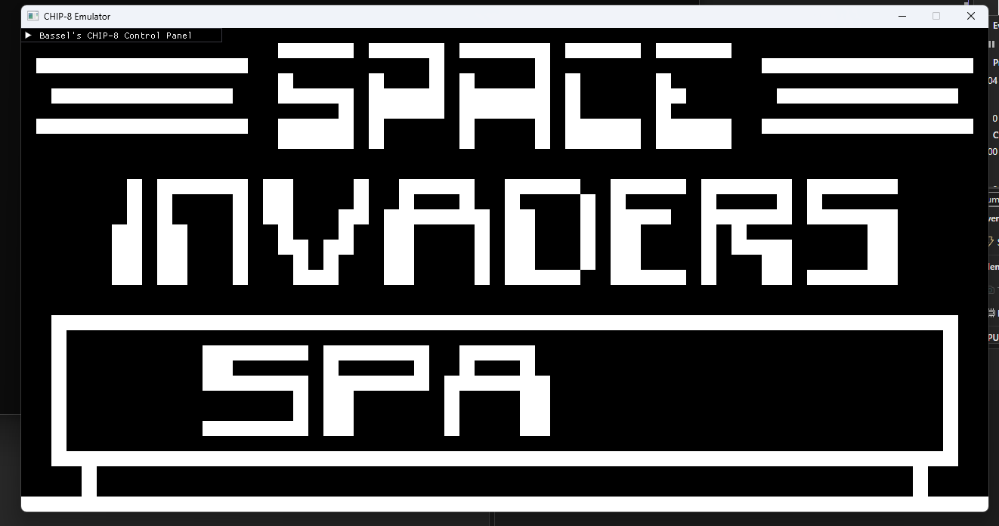

# CHIP-8 Hardware Emulator

A high-performance, cross-platform **CHIP-8 virtual machine interpreter** written in C and C++. This project demonstrates low-level systems programming, instruction decoding, precise hardware timing, and seamless interop between a pure C core and a modern C++/SDL2/ImGui frontend.



---

## 🏛 Architecture & Design

The project is architected with a strict separation of concerns between the execution core and the platform rendering layer:

* **Portable C Core (`core/`):** Implements the full CHIP-8 hardware state (4 KB RAM, sixteen 8-bit registers, index register `I`, program counter `PC`, 16-level call stack, 64×32 monochrome display buffer, 16-key keypad, and hardware timers). It contains zero external dependencies (no SDL/ImGui references) and exposes a minimal C API (`chip8_init`, `load_rom`, `chip8_cycle`).
* **C++ Frontend (`frontend/`):** Built with **SDL2** for video/audio pipelines and **Dear ImGui** for real-time control panels. It communicates with the core strictly across an `extern "C"` boundary.
* **Audio System:** Features an SDL2 audio callback generating a synthesized 440 Hz square wave when `sound_timer > 0`.
* **Memory Safety:** Hardened against malformed ROMs with bitmasking (`& 0x0FFF`) on all memory accesses and explicit boundary checks on the call stack.

---

## 🚀 Features

- **Full Opcode Coverage:** Implements all 34 standard CHIP-8 opcodes, including offset jumps (`BNNN`).
- **Standard Quirk Behaviors:** Configured for standard CHIP-8 semantics (ALU flag ordering, non-incrementing `I` on `FX55`/`FX65`).
- **Interactive Control Panel:**
  - Real-time ROM selector.
  - Play, Pause, and Reset functionality.
  - Adjustable CPU execution speed (1–30 cycles per frame).
- **Sound Synthesis:** Hardware sound timer mapped directly to audio generation.

---

## 🎮 Keybindings

The original 16-key hexadecimal keypad is mapped to standard QWERTY keys:

| CHIP-8 Keypad | Keyboard Layout |
| :---: | :---: |
| `1` `2` `3` `C` | `1` `2` `3` `4` |
| `4` `5` `6` `D` | `Q` `W` `E` `R` |
| `7` `8` `9` `E` | `A` `S` `D` `F` |
| `A` `0` `B` `F` | `Z` `X` `C` `V` |

---

## 🛠 Building and Running

### Prerequisites
- C/C++ Compiler (GCC, Clang, or MSVC)
- **SDL2** Library
- **Dear ImGui** (Included/Linked)

### Compilation (GCC Example)
```bash
g++ -std=c++17 src/main.cpp src/chip.c src/display.c \
    -Iinclude -lSDL2 -lSDL2main \
    -o chip8_emulator
🧪 Validated Games & ROMs
Tested and verified against classic CHIP-8 software and standard test suites:

Pong

Tetris

Space Invaders

IBM Logo

👤 Author
Bassel Aqeel

Computer Science Student | Systems & Low-Level Development Enthusiast

GitHub: baselaqeel00

LinkedIn: Bassel Aqeel